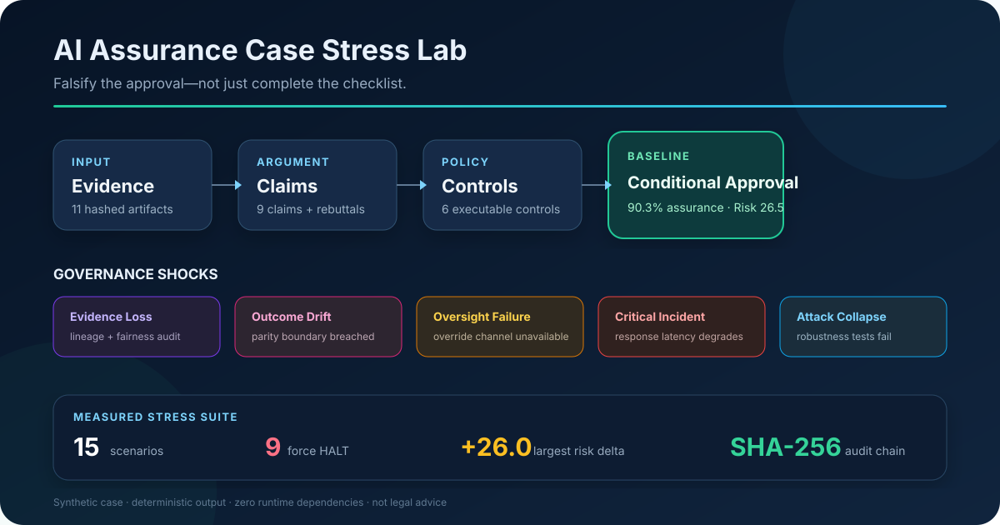
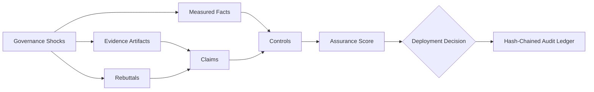

# AI Assurance Case Stress Lab

[](https://github.com/JithuVathiath/ai-assurance-case-stress-lab/actions/workflows/ci.yml)
[](https://nodejs.org/)
[](LICENSE)

**A policy-as-code laboratory that asks a harder question than “Is the
checklist complete?”: _Does the approval survive when its evidence, controls,
and operating assumptions fail?_**



Most AI-governance repositories stop at static questionnaires or framework
crosswalks. This project constructs an evidence-linked assurance argument,
records rebuttals, executes measurable control thresholds, and then attacks its
own approval through counterfactual governance shocks.

The worked example is a synthetic consumer-credit decision-support system. It
is deliberately imperfect: the baseline contains a material fairness sampling
limitation, so the engine produces a conditional decision rather than a polished
but unrealistic all-green scorecard.

## Measured Results

These values are generated by the committed case and reproduced in CI—there are
no placeholder metrics.

| Result | Measured Value |
| --- | ---: |
| Baseline decision | **APPROVE_WITH_CONDITIONS** |
| Evidence-weighted assurance | **90.3%** |
| Residual risk | **26.5 / 100** |
| Controls evaluated | **6** |
| Claims / evidence records | **9 / 11** |
| Single + pairwise compound shocks | **5 + 10** |
| Scenarios forcing `HALT` | **9 / 15** |
| Largest simulated risk increase | **+26.0 points** |
| Minimal one- or two-evidence cut sets | **6** |
| Policy-sensitivity evaluations | **54** |

The top decision-critical artifact is the feature-level lineage export: losing
it alone changes the decision from conditional approval to `HALT`. That result
comes from leave-one-evidence-out evaluation, not a manually assigned label.

## What Makes This Different

- **Assurance cases, not checklists.** Controls depend on explicit claims,
  evidence, factual tests, and rebuttals.
- **Falsifiable approvals.** Five governance shocks cover evidence loss,
  outcome drift, oversight failure, incident response, and adversarial collapse.
- **Correlated-failure analysis.** Every pair of shocks is composed, exposing
  weaknesses that single-scenario testing misses.
- **Decision-critical evidence.** Each artifact is removed in turn to quantify
  its marginal effect on residual risk and deployment status.
- **Minimal cut-set discovery.** The engine exhaustively searches all single and
  pairwise evidence failures and retains only irreducible paths to `HALT`.
- **Normative sensitivity analysis.** Fifty-four evaluations expose how internal-
  evidence discounts, risk-reduction assumptions, and halt thresholds affect
  the result across baseline and critical-incident conditions.
- **Tamper-evident decisions.** Generated audit events form a SHA-256 hash chain;
  modifying an earlier event invalidates the ledger.
- **Cross-framework traceability.** Controls link to the EU AI Act, NIST AI RMF,
  and ISO/IEC 42001 without pretending that a mapping equals certification.
- **Zero runtime dependencies.** Modern Node.js executes the TypeScript directly,
  reducing supply-chain and setup overhead.

## Decision Architecture



The engine does not infer legal compliance. It makes a governance argument
inspectable: reviewers can trace a decision back through each control and claim
to the evidence content hash that supported it.

## Run the Audit

Requirements: Node.js 22.6 or newer. No package installation is required.

```bash
npm run check
npm run audit
```

The first command validates the case, runs eleven deterministic tests, reproduces
the full audit, and proves that fresh output exactly matches the committed
results. The second writes the human- and machine-readable artifacts to
`reports/generated/`.

To evaluate another case:

```bash
node src/cli.ts audit path/to/case.json --out path/to/output
```

## Generated Evidence Pack

| Artifact | Purpose |
| --- | --- |
| [`executive-report.md`](reports/generated/executive-report.md) | Decision memo, control results, shocks, and critical evidence |
| [`audit-results.json`](reports/generated/audit-results.json) | Complete machine-readable evaluation |
| [`stress-matrix.csv`](reports/generated/stress-matrix.csv) | Scenario matrix for analysis or BI tooling |
| [`policy-sensitivity.csv`](reports/generated/policy-sensitivity.csv) | Complete two-scenario, 54-cell policy grid |
| [`assurance-case.mmd`](reports/generated/assurance-case.mmd) | Renderable claim-control-evidence graph |
| [`audit-ledger.jsonl`](reports/generated/audit-ledger.jsonl) | Verifiable SHA-256 decision history |

## Repository Map

```text
.
├── examples/                 # Synthetic, inspectable system case
├── src/
│   ├── evaluator.ts          # Evidence, claim, control, and decision engine
│   ├── stress.ts             # Single, compound, and evidence-criticality tests
│   ├── ledger.ts             # Hash-chain creation and verification
│   ├── report.ts             # Markdown, JSON, CSV, Mermaid, and JSONL output
│   └── cli.ts                # Dependency-free command-line interface
├── reports/generated/        # Reproducible evidence pack
├── docs/                     # Method, architecture, and framework notes
└── tests/                    # Behavioural, determinism, and tamper tests
```

## Framework Basis and Limits

The illustrative control mapping is grounded in primary sources:

- [Regulation (EU) 2024/1689](https://eur-lex.europa.eu/eli/reg/2024/1689/oj),
  including Articles 9, 10, 14, 15, 72, and 73.
- [NIST AI Risk Management Framework 1.0](https://www.nist.gov/itl/ai-risk-management-framework),
  organised around Govern, Map, Measure, and Manage. NIST notes that AI RMF 1.0
  is being revised; this repository records its reference date.
- [ISO/IEC 42001 overview](https://www.iso.org/artificial-intelligence/ai-management-systems),
  which describes a management-system approach based on continual improvement.

Reference date: **15 September 2026**. See
[`docs/framework-notes.md`](docs/framework-notes.md) for the exact scope and
interpretive limits.

This software is an engineering and research demonstrator. It is **not legal
advice, regulatory certification, or an ISO conformity assessment**. Numerical
thresholds are disclosed portfolio assumptions and must be replaced with an
organisation's approved risk appetite, jurisdictional analysis, and qualified
review before any real-world use.

## Design Documentation

- [Architecture](docs/architecture.md)
- [Scoring and Stress Method](docs/methodology.md)
- [Research Protocol](docs/research-protocol.md)
- [Threats to Validity](docs/threats-to-validity.md)
- [Framework Notes and Limitations](docs/framework-notes.md)
- [Contributing](CONTRIBUTING.md)

## Author

**Jithu Vathiath Biju** — AI governance, data science, financial risk, and
technology consulting portfolio.
