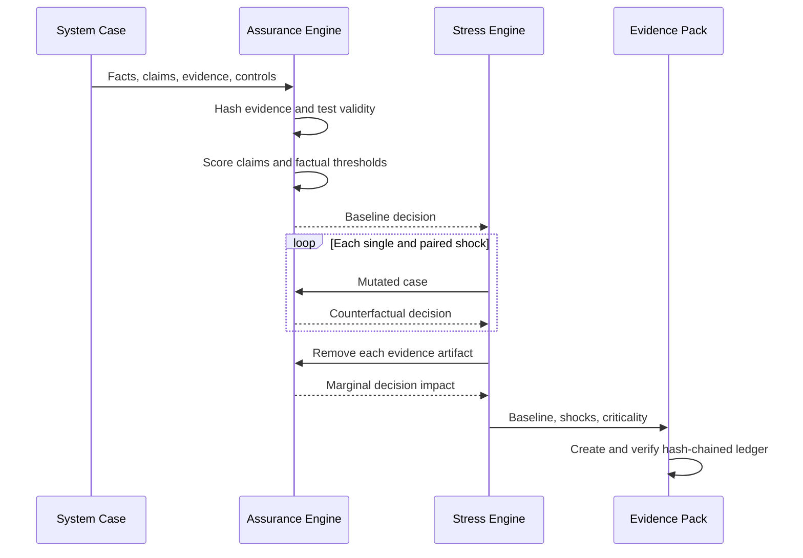

# Architecture

## Core Model

The repository separates five concepts that are often collapsed into one
spreadsheet row:

1. An **evidence record** has provenance, a validity window, ownership,
   independence, confidence, and content that receives a deterministic hash.
2. A **claim** describes what must be defensible and links to one or more
   evidence records.
3. A **rebuttal** records a reason that a supported claim may still fail.
4. A **control** combines claim confidence with executable checks against
   operating facts.
5. A **decision** combines control criticality, residual risk, and critical
   failure gates.

This layout preserves the reasoning chain. A reviewer can distinguish “a file
exists” from “the file supports this claim, remains current, survives this
rebuttal, and is consistent with measured operation.”

## Execution Flow

## Trust Boundaries

- The input case is treated as asserted data, not verified truth.
- Evidence confidence is an explicit input; its content hash only proves
  consistency within the run, not authenticity of the original source.
- The audit ledger detects later modification within the generated sequence; it
  is not a digital signature or external timestamp service.
- Framework mappings provide traceability for expert review; they do not encode
  the full legal text or reproduce copyrighted standards.
